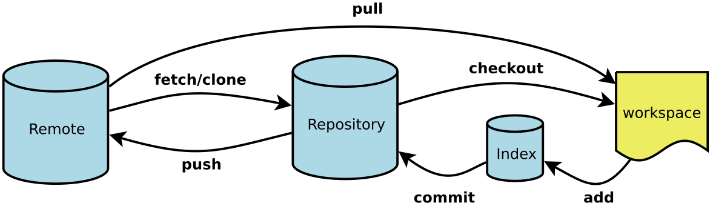
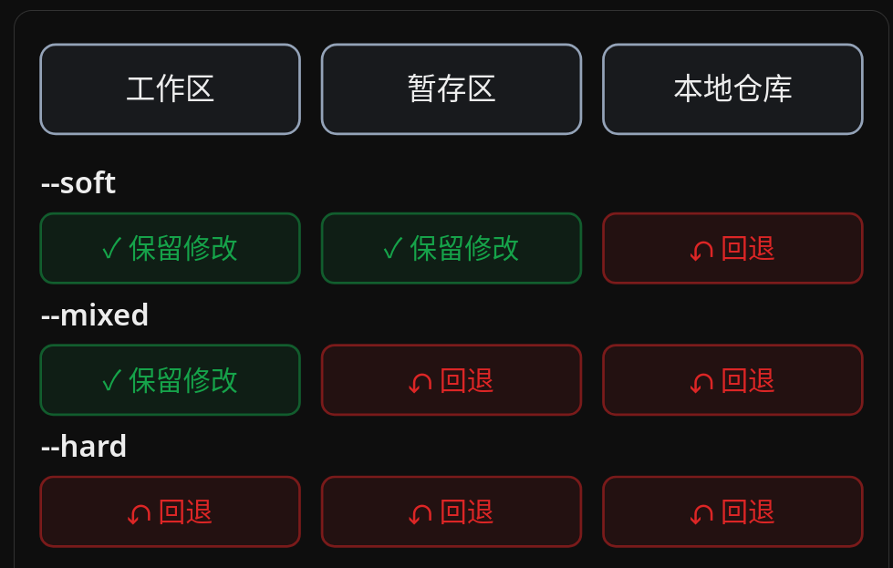

这是一篇git常用命令的总结  
先贴一张图  
  
| name | 翻译 |
| ---- |------ |
| `workspace` | 工作区|
| `index` / `stage` | 暂存区|
| `repository` | 本地仓库 |
| `remote` | 远程仓库|

## git本地配置

git的全局配置文件路径为 ~/.gitconfig

```bash
# 显示当前 Git 配置
git config --list

# 编辑全局 Git 配置文件
git config --global -e

# 设置提交时用的姓名和邮箱 首次使用git必须设置
git config --global user.name "你的名字"
git config --global user.email "you@example.com"
```

## 新建仓库

```bash
# 在当前目录初始化git仓库
git init

# 下载某个项目
git clone [url]

```

## 代码提交

```bash
# 将文件添加到暂存区
git add [filename1] [filename2] [...]

# 将当前目录及其子目录的改动添加到暂存区
git add .

# 提交暂存区到本地仓库
git commit -m "[message]"

# 提交工作区的指定文件到本地仓库
git commit [filename1] [filename2] [...] -m "[message]"

# 创建新提交来替换上次的提交
git commit --amend -m "[message]"
git commit --amend [filename1] [filename2] [...] -m "[message]"

```

## 查看信息

```bash
# 查看最近一次提交以来的变化
git status

# 查看commit历史
git log

# 查看commit历史 (reader friendly版)
git log --all --graph

# 查看commit历史 (reader friendly and simple版)
git log --all --graph --oneline

# 显示暂存区和工作区的差异
git diff

# 显示从某个commit以来的所有变化
git diff [commit]

# 显示从某个commit以来指定文件的变化
git diff [commit] [filename1] [filename2] [...]

# 显示从commit1到commit2的所有变化
git diff [commit1] [commit2]

# 显示从commit1到commit2的指定文件的变化
git diff [commit1] [commit2] [filename1] [filename2] [...]

# 查看某次commit的信息 默认查看最近一次的commit
git show [commit]

# 查看某次commit的关于指定文件的信息
git show [commit]:[filename]

# 查看哈希值对应的对象信息 可以是commit blob tree
git cat-file -p [hash]

# 查看某个文件每一行最后由哪个提交修改
git blame [filename]

```

## 分支

```bash
# 列出本地分支
git branch

# 列出所有本地和远程分支
git branch -a

# 新建一个分支 (不会自动切换到新分支)
git branch [branch_name]

# 新建一个分支并自动切换
git checkout -b [branch_name]

# 从指定的commit处新建一个分支
git branch [branch_name] [commit]

# 切换到指定分支 (注意保存当前工作区文件!!!)
git checkout [branch_name]

# 切换到上一个分支
git checkout -

# 删除分支
git branch -d [branch_name]

# 合并所有指定分支到当前所在分支
git merge [branch_name1] [branch_name2] [...]

# 解决合并冲突之后 继续执行合并
git merge --continue

```

## 引用/标签 (tag)

~~标签是一种可以让人类免于记忆40位无意义字符串的技术~~  
本文中的所有[commit]均可以用[tag_name]来替换

```bash

# 列出所有tag
git tag

# 给指定commit创建一个tag 不写commit默认给当前commit创建tag
git tag [tag_name] [commit]

# 删除指定标签
git tag -d [tag_name]

# 查看tag信息
git show [tag_name]

```

## 恢复文件

```bash

# 从暂存区恢复文件到工作区
# 会丢弃工作区中未暂存的修改 (二选一即可)
git checkout [filename1] [filename2] [...]
git restore [filename1] [filename2] [...]

# 从最近一次 commit 恢复文件到暂存区
# 即撤销 git add，不影响工作区 (二选一即可)
git reset [filename1] [filename2] [...]
git restore --staged [filename1] [filename2] [...]

# git restore的参数设计的很有规律
# --source 表示文件来源  --staged 表示恢复到暂存区  --worktree表示恢复到工作区
# 恢复文件到工作区时默认文件来源是暂存区
# 恢复文件到暂存区时默认文件来源是最近一次commit

# 从最近一次 commit 直接恢复文件到工作区 不影响暂存区
git restore --source=HEAD [filename1] [filename2] [...]

# 从最近一次 commit 同时恢复暂存区和工作区
git restore --source=HEAD --staged --worktree [filename1] [filename2] [...]

# 从指定 commit 恢复文件到工作区
git restore --source=[commit] [filename1] [filename2] [...]

```

## 撤销add或commit

```bash

# 从最近一次 commit 恢复文件到暂存区
# 即撤销 git add，不影响工作区 (二选一即可)
git reset [filename1] [filename2] [...]
git restore --staged [filename1] [filename2] [...]

# git reset的参数设计的也很有规律
# 有--soft --mixed --hard三个选项

# 撤销最近一次提交
# 不影响工作区和暂存区
git reset --soft HEAD~1

# 回到某次commit 默认是最近一次
# 不影响工作区和暂存区
git reset --soft [commit]

# 回到某次commit 并回退暂存区
# 不影响工作区
git reset --mixed [commit]

# 回到某次commit 并回退暂存区和工作区
# 有危险 未提交的修改会丢失!
git reset --hard [commit]

# 新建一个commit 这个commit的效果是所指定commit的逆
# 最终效果是所指定commit被抵消 但实际是新加了个commit
git revert [commit]

```

这里贴一张图帮助记忆


## 远程仓库相关

```bash

# 列出当前绑定的远程仓库
git remote
git remote -v

# 绑定远程仓库
# remote_name一般写origin 不过这只是个习惯问题
git remote add [remote_name] [remote_url]

# 解绑远程仓库
git remote remove [remote_name]

# 重命名仓库
git remote rename [old_remote_name] [new_remote_name]

# 克隆远程仓库到本地(含提交历史)
git clone [remote_url]

# 克隆远程仓库到本地(仅当前commit 不含提交历史)
git clone --depth 1 [remote_url]

# 上传本地的指定分支到远程
# 加-u参数(表示设置上游分支)运行一次之后 相同操作只需输入git push
git push [remote_name] [branch]

# 从远程仓库获取更新 整合到当前分支
# 设置上游分支之后 只需输入git pull
git pull [remote_name] [branch]

```

## 其他

```bash
# 临时保存当前工作区的更改 默认只保存已跟踪文件的修改
git stash push

# 恢复先前所临时保存的更改
git stash pop

```

在工作区下加.gitignore文件可以设置不被git追踪的文件
